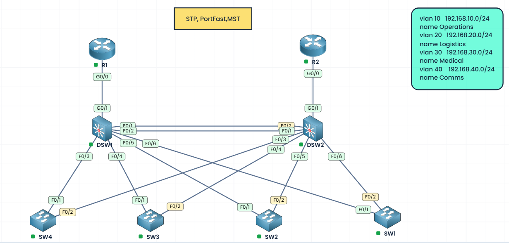

# CCNA
SPT MST, PORTFAST
# CCNA Switching Lab: Multiple Spanning Tree (MST)

## Overview

This project documents my hands-on CCNA 200-301 switching lab using the PingMyNetwork Sandbox.

The focus is Multiple Spanning Tree (MST), including MST region configuration, VLAN-to-instance mapping, root bridge election, redundant links, and verification using Cisco IOS commands.

## Lab Environment

- **Platform:** [PingMyNetwork Sandbox](https://pingmynetwork.com/sandbox)
- **Technology:** Multiple Spanning Tree (MST)
- **Region Name:** CCNP
- **Revision Number:** 5
## Network Topology



The topology consists of:

- 2 distribution switches: DSW1 and DSW2
- 4 access switches: SW1, SW2, SW3, and SW4
- 2 routers: R1 and R2
- Redundant switch links
- 4 VLANs

## VLAN and MST Instance Mapping

| VLAN | Name | Network | MST Instance |
|---|---|---|---|
| 10 | Operations | 192.168.10.0/24 | MST 1 |
| 20 | Logistics | 192.168.20.0/24 | MST 1 |
| 30 | Medical | 192.168.30.0/24 | MST 2 |
| 40 | Comms | 192.168.40.0/24 | MST 2 |

## MST Region Configuration

Apply the same region configuration to all six switches.

```cisco
spanning-tree mode mst

spanning-tree mst configuration
 name CCNP
 revision 5
 instance 1 vlan 10,20
 instance 2 vlan 30,40
 exit
```

## Root Bridge Design

| Switch | Role | MST 1 Priority | MST 2 Priority |
|---|---|---:|---:|
| DSW1 | Primary root | 4096 | 4096 |
| DSW2 | Secondary root | 8192 | 8192 |

### DSW1 — Primary Root Bridge

```cisco
spanning-tree mst 1 priority 4096
spanning-tree mst 2 priority 4096
```

### DSW2 — Secondary Root Bridge

```cisco
spanning-tree mst 1 priority 8192
spanning-tree mst 2 priority 8192
```

These priorities make DSW1 preferred over DSW2 for MST instances 1 and 2, provided no other switch has a lower bridge ID.

## Verification Commands

```cisco
show spanning-tree mst configuration
show spanning-tree mst
show spanning-tree mst 1
show spanning-tree mst 2
show spanning-tree summary
```

### Verification Checklist

- [ ] All six switches have matching MST region configurations.
- [ ] VLANs 10 and 20 map to MST instance 1.
- [ ] VLANs 30 and 40 map to MST instance 2.
- [ ] DSW1 is the root bridge for MST instances 1 and 2.
- [ ] DSW2 is configured as the secondary root.
- [ ] Redundant links have the expected spanning-tree port roles and states.
- [ ] Root bridge failover and reconvergence have been tested.

## Repository Structure

```text
CCNA/
├── README.md
├── topology/
│   └── STP.png
└── labs/
    └── MST/
        ├── README.md
        ├── configurations/
        └── verification/
```

## Learning Outcomes

This lab demonstrates practical understanding of MST region consistency, VLAN mapping, bridge priority, root bridge election, and redundant Layer 2 network design.

## Lab Resources

- [PingMyNetwork Sandbox](https://pingmynetwork.com/sandbox)

**Status:** In progress — configuration and verification results will be documented as the lab develops.
